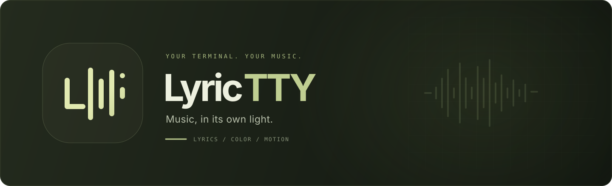
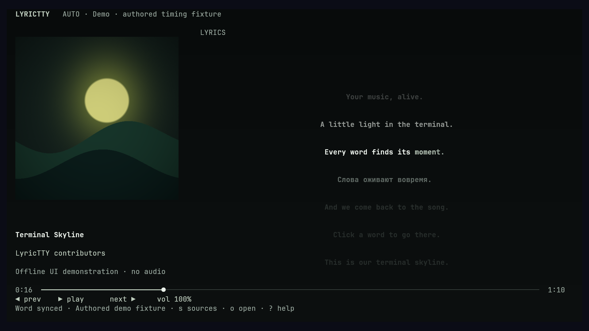

<div align="center">



**Synced lyrics. Adaptive color. A home for music in your terminal.**

[](https://github.com/6axam/LyricTTY/actions/workflows/ci.yml)
[](https://www.rust-lang.org/)
[](#install)
[](LICENSE)

[Install](#install) · [Play](#play) · [Controls](#controls) · [Word sync](docs/word-sync.md) · [Configuration](docs/configuration.md)

</div>

## A quieter stage for your music

LyricTTY brings playback, artwork and synchronized lyrics into one terminal view. Connect an existing MPRIS player or open a URL or local file in its own mpv player.

- **Lyrics that follow the song.** Word highlighting when timestamps are available, line/plain-text fallbacks, lyric seeking and a focused karaoke layout.
- **Color drawn from the cover.** Square artwork, adaptive dark palettes and smooth theme transitions.
- **Motion with room to breathe.** Pixel-positioned lyrics in compatible Kitty sessions; a terminal renderer elsewhere.
- **Sound between the lines.** Real CAVA spectrum during instrumental gaps, using the default playback-output monitor.
- **Preparation in the background.** Local CPU alignment adds missing word cues while music continues; prepared timings are cached for later listens.

<p align="center">
  
  <br>
  <sub>Captured in Kitty from the current silent demo. Original artwork and authored lyrics; no live audio or recognition is simulated.</sub>
</p>

**Pre-release.** LyricTTY is under active development; the Cargo package version does not announce a release. Normal startup discovers real players. The visual fixture runs only with `--demo`.

## Install

Linux, a Rust toolchain, a session D-Bus and a truecolor terminal are required. Kitty enables pixel lyrics and Kitty Graphics artwork.

```bash
# Arch Linux / Omarchy
sudo pacman -S --needed git rust mpv yt-dlp ffmpeg fontconfig cava

git clone https://github.com/6axam/LyricTTY.git
cd LyricTTY
./install.sh
lyrictty
```

The installer builds and places `lyrictty` in `~/.local/bin`; add that directory to `PATH`. Set `LYRICTTY_PREFIX` to change the installation prefix. mpv and yt-dlp support owned playback; external MPRIS playback can be used without them. The `cava` executable is optional and enables the instrumental spectrum.

To prepare missing word timings locally, run the one-time setup:

```bash
./scripts/setup-alignment.sh base
```

This downloads a CPU runtime and the multilingual Whisper base model. See [word sync](docs/word-sync.md) for behavior, resource use and limitations.

## Play

```bash
lyrictty                                      # Discover existing MPRIS players
lyrictty 'https://music.youtube.com/watch?v=VIDEO_ID'
lyrictty /path/to/music.flac
lyrictty --lyrics /path/to/song.lrc            # Explicit lyrics for the selected source
lyrictty --demo                               # Silent, authored visual fixture
lyrictty doctor                               # Diagnose the local setup
```

Press `o` inside the app to open a URL or file. Owned playback uses mpv JSON IPC, with yt-dlp for public YouTube and YouTube Music URLs. Account libraries, private playlists and recommendations are not implemented; browser cookies and account secrets are not collected.

For external playback, start music in a browser or player exposing MPRIS on the same session D-Bus. Auto selects the only playing source; simultaneous playback opens a selector. Press `s` to choose. Seeking and transport depend on the source's reported capabilities; some browsers disable seeking or expose only the current track.

## Controls

| Input | Action |
| :--- | :--- |
| `Space` | Play / pause |
| `n` / `p` | Next / previous, when supported |
| `x` / `R` | Shuffle / repeat track, when supported |
| `←` / `→` or `h` / `l` | Seek −5 / +5 seconds |
| `↑` / `↓` or `k` / `j` | Raise / lower volume |
| `s` | Select source, including Auto |
| `o` or `/` | Open URL or local file |
| Wheel over lyrics, `PgUp` / `PgDn` | Browse lyrics |
| `Enter` | Seek to selected lyric |
| `f` | Return to live lyrics |
| `L` / `Esc` | Toggle / leave karaoke layout |
| `,` / `?` | Settings / help |
| `q` / `Ctrl+C` | Exit |

Click a timed lyric, word or progress bar to seek. Wheel outside the lyrics changes volume. Paste URLs into the open dialog.

## Lyrics and word sync

Use local enhanced LRC or Lyricsfile JSON/YAML, or let LyricTTY look up lyrics through LRCLIB. Available cues determine the display: word → line → plain text → no lyrics. Ordinary line timestamps do not become invented word timings.

Optional stable-ts `align_words()` aligns the **existing lyrics** to separately loaded audio, using line timestamps as anchors and preserving original text. Music continues by default. Completed lines appear incrementally; prepared timelines persist in the `stable-words-v1` disk cache.

Alignment runs on CPU at low priority. `alignment_threads = 0` uses all available CPU threads; a positive value limits the budget. `prefetch_tracks = 3` prepares up to three actual upcoming tracks from an mpv playlist or MPRIS TrackList. Browsers may not expose a queue, and unpredictable MPRIS shuffle order disables speculative preparation.

**Full text coverage is not a promise of exact acoustic timing.** Singing, accompaniment and source timestamps can affect the result. Read [how alignment works](docs/word-sync.md), including cache behavior and privacy.

## Make it yours

Settings live in `~/.config/lyrictty/config.toml`. Press `,` for the main options, or browse the [configuration reference](docs/configuration.md).

Kitty pixel lyrics require Kitty Graphics and a suitable font discovered through fontconfig. Other terminals and unsupported text use the terminal renderer. Disable `pixel_lyrics` for terminal text selection or screen readers. Lower FPS or enable low-data mode to reduce work; low-data mode skips artwork downloads.

If something is missing, start with `lyrictty doctor`. Check that the player shares your D-Bus session, update yt-dlp if public URL extraction fails, and install `cava` for the output-monitor spectrum. Lyrics availability and community timing quality vary.

## Explore the project

[Configuration](docs/configuration.md) · [Word sync](docs/word-sync.md) · [Architecture](docs/architecture.md) · [Verification notes](docs/acceptance.md)

[Known issues](docs/known-issues.md)

[Contributing](CONTRIBUTING.md) · [Changelog](CHANGELOG.md) · [MIT license](LICENSE)

CI checks formatting, Clippy, tests, a release build and CLI help. Queue editing, session persistence and account/library features remain outside the current milestone.
