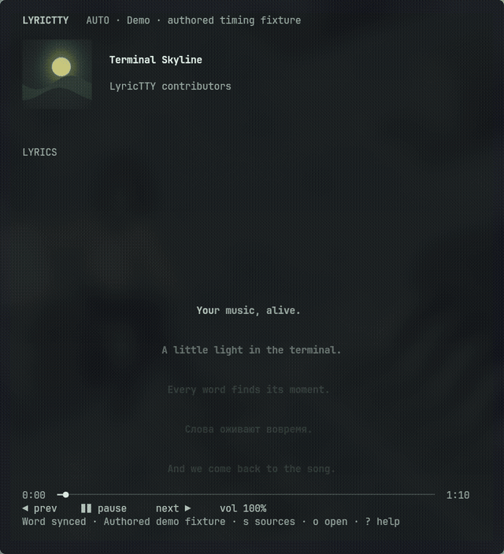

# LyricTTY

Spotify-like synced lyrics and adaptive music UI for your terminal.

[](https://github.com/6axam/LyricTTY/actions/workflows/ci.yml)
[](https://www.rust-lang.org/)
[](LICENSE)


**Pre-release / development.** The Cargo package number is technical; no `v0.1.0` release is declared. The screenshot shows the explicit silent demo, with original artwork and authored lyrics. Normal startup discovers real players and never simulates playback.

## What works

- Native URL/local-file playback through an owned **mpv JSON IPC** process, with yt-dlp for public YouTube / YouTube Music URLs.
- Direct **D-Bus/MPRIS2** discovery and control of any compatible browser/player; no playerctl dependency or browser-specific branches.
- Source Auto chooses the only playing source; simultaneous playback opens a selector.
- Local enhanced LRC and Lyricsfile JSON/YAML; online **LRCLIB** with word → line → plain → no-lyrics fallback and disk caching.
- Actual word timestamps drive completed/current/future word colors and partial word progress. Ordinary LRC is never given invented word timing.
- Optional local audio recognition learns missing word timings from playback and caches matched words for future listens.
- Pixel-smooth lyrics in Kitty: cached text images move at sub-cell offsets with larger typography and no doubled rows. Other terminals keep eased row blending. Both paths retain line/word seek.
- Mouse seeking, manual lyric browsing, return to LIVE, and a minimal karaoke layout.
- Cached artwork, dominant-color dark themes with contrast checks, smooth theme transitions, and Kitty Graphics (truecolor halfblocks elsewhere).
- Instrumental passages show a CAVA spectrum from the default playback-output monitor; the process runs only during those passages.
- Compact / Standard / Wide layouts, in-app settings, and idle frame scheduling.

## Install

Linux with a Rust toolchain, session D-Bus, and a truecolor terminal. Kitty is recommended.

```bash
# Arch / Omarchy: install native playback dependencies
sudo pacman -S --needed rust mpv yt-dlp fontconfig
git clone https://github.com/6axam/LyricTTY.git
cd LyricTTY
./install.sh
lyrictty
```

The installer places the binary in `~/.local/bin`; override with `LYRICTTY_PREFIX`. Ensure its `bin` directory is on `PATH`. `PKGBUILD` also supports `makepkg -si` from a clean packaging directory. mpv and yt-dlp are optional when using only MPRIS.

## Play music

```bash
lyrictty                                      # Auto: existing MPRIS source
lyrictty 'https://music.youtube.com/watch?v=VIDEO_ID'
lyrictty /path/to/music.flac
lyrictty --lyrics /path/to/song.lrc            # Lyrics for the selected source
lyrictty --demo                               # Offline, silent visual fixture
lyrictty doctor
```

Inside the app, press `o` to open a URL or path. Public YouTube Music playback does not require an account. Private libraries, OAuth setup, liked songs, and recommendations are not implemented. No browser cookies or account secrets are collected.

### Browser / MPRIS

Start music in a browser that exposes `org.mpris.MediaPlayer2.*`, then start LyricTTY or press `s`. Playback metadata, capabilities, property changes and seeks come directly from D-Bus. Position is extrapolated locally, with sparse position-only resync. A browser may expose `CanSeek=false`; LyricTTY then explains why lyric/progress seeking is unavailable.

## Controls

| Input | Action |
|---|---|
| `Space` | Play/pause |
| `n` / `p` | Next/previous when supported |
| `←` / `→`, `h` / `l` | Seek ±5 seconds |
| `↑` / `↓`, `k` / `j` | Volume |
| `s` | Source selector, including Auto |
| `o` or `/` | Open URL/local-file dialog |
| Wheel over lyrics, `PgUp` / `PgDn` | Browse lyrics |
| `Enter` | Seek to selected lyric |
| `f` | Return to live lyrics |
| `L`, `Esc` | Enter/leave karaoke layout |
| `,` / `?` | Settings / help |
| `q` / `Ctrl+C` | Exit |

Click a timed lyric/word or progress bar to seek. Transport controls and the source list accept mouse clicks. Wheel outside lyrics changes volume. URL paste is accepted only in the open dialog.

## Word-sync demonstration

```bash
lyrictty --demo
```

The included [authored timing fixture](examples/demo.lrc) has real explicit word cues, Cyrillic, and an instrumental gap. It is deliberately silent and labeled as a demo. For music, pass your own timestamped file with `--lyrics` alongside a native URL or active browser source. LRCLIB word timing is used only when the server supplies a valid Lyricsfile; most records remain line-synced.

### Align the existing lyrics to audio

```bash
./scripts/setup-alignment.sh base  # Multilingual stable-ts alignment, CPU only
lyrictty
```

Requires `ffmpeg`, `ffprobe`, and `yt-dlp` for public remote audio. LyricTTY obtains a separate audio file and aligns the existing text to audio on a background worker. Local files and direct source URLs are preferred. If browser metadata has no source URL, a bounded public lookup requires matching artist/title/version and duration; uncertain recordings are rejected. No browser cookies or account credentials are used.

Music starts immediately by default (`prepare_before_playback = false`). Until word cues are ready, line lyrics remain available. Completed lines are published incrementally; a full prepared cache is accepted only when every lexical word has a finite acoustic interval or an explicit point cue for a short particle and the original text is reconstructed exactly. A partial result is never labeled 100% prepared.

Stable-ts `align_words()` uses the existing line timestamps as anchors, preserving all original words, spelling, whitespace and punctuation. Failed lines are retried independently. Missing word cues produce a visible coverage error rather than uniform fabricated timestamps. A collapsed cue for a short particle (up to two letters), bracketed by timed neighbors, stays an explicit point cue; no duration is invented for it. Complete text coverage does not guarantee perfect acoustic timing: singing, accompaniment and inaccurate source line boundaries can still impair alignment.

The original multilingual Whisper base model runs locally in float32 at low priority. Preparation uses all available CPU threads by default (`alignment_threads = 0`); set a positive value to limit it. Only one model task runs at once to bound memory. No GPU is used. This runtime/model is larger than the old Vosk setup; installation is a one-time download. Old Vosk caches are kept separate and never accepted as complete stable-ts results. Prepared timelines are reused without loading the model. Temporary audio is deleted after analysis; no audio is uploaded or captured from the microphone. Set `audio_alignment = false` to disable analysis, or explicitly opt into waiting with `prepare_before_playback = true`.

After the active track is prepared, LyricTTY preloads lyrics and acoustic timelines for up to three actual upcoming tracks (`prefetch_tracks = 3`, configurable 0–3). The active song always has priority: switching tracks interrupts speculative analysis and reuses any completed work. Cached timelines are shared between queue entries and active tracks using recording metadata and lyric content; old URL-specific cache entries remain readable.

Upcoming tracks are discovered through mpv's playlist or the standard MPRIS TrackList interface. Browsers that expose only the current song cannot provide an upcoming queue; the UI reports that no following tracks are available. MPRIS shuffle order is not predictable from TrackList, so speculative preparation is skipped while shuffle is enabled. Missing native queue tags are resolved separately with ffprobe/yt-dlp before lookup. No tracks are skipped or played to discover the queue.

[Kitty pixel scrolling — actual 60 FPS recording](assets/smooth-lyrics.mp4)

Portable terminal fallback preview:



## Configuration and performance

Settings live in `~/.config/lyrictty/config.toml`; `,` edits the main options and saves immediately. Defaults: 60 FPS while animating, 850ms lyric movement, 900ms theme transition, and eight-second manual-follow timeout. Frame deadlines account for drawing time, and paused static screens are not redrawn continuously. Use 15/30 FPS and low-data mode to reduce work; low-data mode skips artwork downloads.

`pixel_lyrics = true` enables the smooth Kitty path when Kitty Graphics and a suitable system font are available. Font discovery uses `fontconfig` (`fc-match`); `LYRICTTY_LYRICS_FONT` can select a local TTF/OTF. Unsupported scripts, emoji/combining graphemes, tmux and other terminals fall back to the terminal renderer. Pixel lyrics are images; disable the option for terminal text selection or screen readers. The setting can be changed live in `,`.

See [all settings](docs/configuration.md), [architecture](docs/architecture.md), and [verification notes](docs/acceptance.md).

## Troubleshooting and current limits

- Run `lyrictty doctor`; launch from the same user session as the browser. `playerctl` is not required.
- If colors are missing, check `NO_COLOR`. That environment variable is respected.
- yt-dlp/YouTube availability and extraction speed vary. Update yt-dlp through your package manager when extraction fails.
- Lyrics availability and community timing quality vary. Displayed video titles are conservatively normalized for catalog lookup; Live/Remix qualifiers are preserved.
- Outside Kitty's pixel renderer, terminal glyphs occupy whole cells. The ANSI fallback blends adjacent rows and may have a soft doubled edge. In Kitty, set FPS to 60 and enable Pixel lyrics in `,` for the smoothest available mode.
- Instrumental detection uses timed lyric gaps. Install `cava` for the real audio spectrum (PulseAudio/PipeWire output monitor); absent CAVA shows an unavailable label. No microphone is used.
- Karaoke minimizes the interface; Kitty pixel lyrics also use larger type. The terminal fallback uses the terminal's font size.
- A session D-Bus restart requires restarting LyricTTY. Individual player disappearance/replacement is handled live.
- Session/queue persistence, a queue editor, catalog search and account/library features remain outside this development milestone.

## Development

```bash
cargo fmt --all -- --check
RUSTFLAGS='-D warnings' cargo clippy --all-targets -- -D warnings
RUSTFLAGS='-D warnings' cargo test
cargo build --release --locked
```

Tests use a private mock MPRIS bus, mock Unix IPC, loopback HTTP and local fixtures. Real headless mpv tests run when mpv is installed; CI installs it. No test requires YouTube or a user account. Opt-in live probes are available in `examples/verify_backends.rs`.

MIT licensed. See [CHANGELOG.md](CHANGELOG.md) and [CONTRIBUTING.md](CONTRIBUTING.md).
